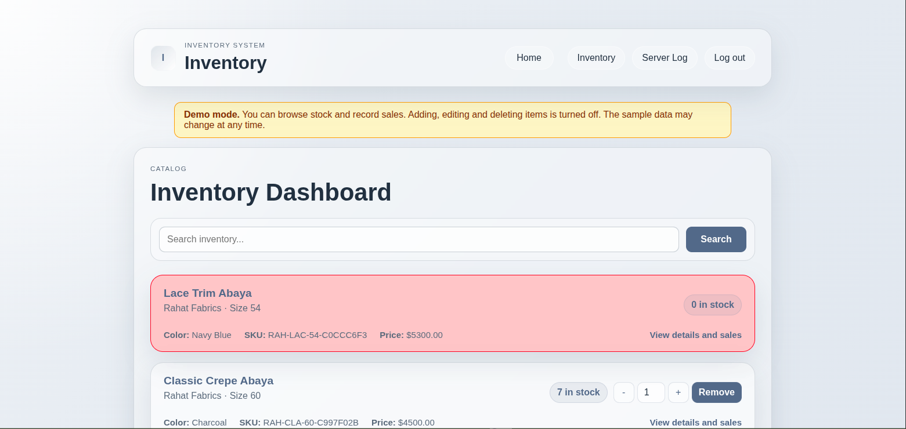
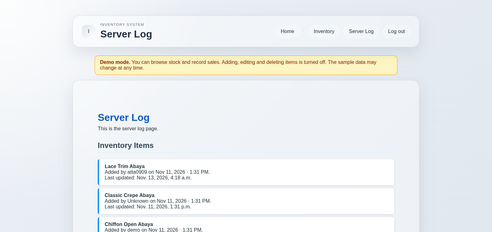
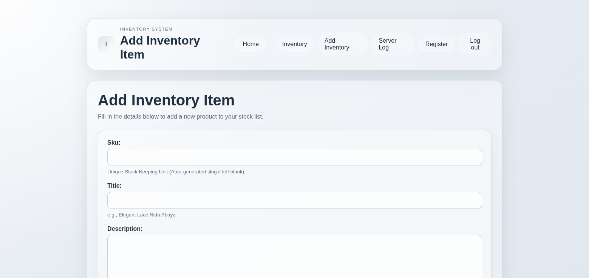

# Inventory & Sales Management System

A Django web application for tracking clothing stock (abayas) and recording sales. It handles stock levels, cost and selling prices, profit and inventory-value reporting, per-item sales history, low-stock email alerts, and a staff activity log.

Built with Django 6.1 and SQLite. Good for small retail shops that need a simple, self-hosted system. The same structure works for other clothing, fabric, or general retail inventory with small model changes.

## Features

- **Inventory catalog**: items with title, brand, colour, material, description, and status.
- **Managed sizes**: sizes are database records you add, edit, or retire in the Django admin, with an optional fit guide. No code change is needed to add a size. Sizes in use by items are protected from deletion.
- **Automatic SKU generation**: a unique SKU is created from brand, title, size and a random suffix if none is entered.
- **Point-of-sale style stock removal**: sell one or more units from the dashboard. Stock is locked during the update so two sales can't both take the last piece.
- **Sales validation**: rejects non-numeric or zero quantities, out-of-stock items, and quantities larger than what's on hand.
- **Sales history**: per-item sales list and a full server log of inventory changes and sales.
- **Profit and value calculations**: potential profit per unit and capital tied up in stock.
- **Low-stock alerts**: emails the shop owner when an item's stock drops to the threshold (default 5).
- **Login-protected**: all pages require a signed-in user. Only staff can register new users.
- **Admin site**: Django admin for direct data management.

## Screenshots





## Tech stack

- Python 3.12 or newer (Django 6.1 requires it)
- Django 6.1
- SQLite (default; swap in PostgreSQL via `DATABASES` for larger deployments)
- Plain HTML/CSS templates (no JavaScript framework)

## Project structure

```
inventorySales/
├── manage.py
├── requirements.txt
├── inventorySales/        # project settings, root URLs, home page view
├── inventory/             # stock items, sales, dashboard, forms, tests
│   ├── models.py          # Size, AbayaInventoryItem, SaleTransaction
│   ├── migrations/        # 0005 moves sizes from integers into the Size table
│   ├── views.py           # dashboard, sales, add/update/delete, server log
│   ├── forms.py
│   ├── urls.py
│   ├── templates/inventory/
│   └── tests.py
├── users/                 # login, logout, staff-only registration
├── templates/             # shared base layout and home page
└── static/css/style.css
```

## Getting started

### 1. Clone and set up a virtual environment

```bash
git clone <your-repo-url> inventorySales
cd inventorySales
python -m venv .venv
source .venv/bin/activate        # Windows: .venv\Scripts\activate
pip install -r requirements.txt
```

### 2. Configure environment variables (optional for local development)

The settings read these variables. Local development runs with defaults; production requires a secret key.

| Variable | Purpose | Default |
|---|---|---|
| `DJANGO_SECRET_KEY` | Django secret key (required when `DJANGO_DEBUG=False`) | dev-only key |
| `DJANGO_DEBUG` | `True` or `False` | `True` |
| `DJANGO_ALLOWED_HOSTS` | Comma-separated hostnames | `127.0.0.1,localhost` |
| `DJANGO_EMAIL_HOST_USER` | SMTP username for alert emails | empty |
| `DJANGO_EMAIL_HOST_PASSWORD` | SMTP password or app password | empty |
| `DJANGO_EMAIL_HOST` / `DJANGO_EMAIL_PORT` | SMTP server | `smtp.gmail.com` / `587` |
| `DJANGO_ADMIN_EMAIL` | Address that receives low-stock alerts | empty (alerts disabled) |
| `DJANGO_FROM_EMAIL` | Sender address for alerts | same as SMTP user |
| `DJANGO_EMAIL_BACKEND` | Set to the SMTP backend to send real mail | console backend (prints to terminal) |

Example for Linux/macOS:

```bash
export DJANGO_SECRET_KEY="$(python -c 'import secrets; print(secrets.token_urlsafe(50))')"
export DJANGO_DEBUG=False
export DJANGO_ALLOWED_HOSTS="shop.example.com"
```

Put these in a `.env` file loaded by your process manager or shell. The `.gitignore` already excludes it.

### 3. Create the database and an admin user

```bash
python manage.py migrate        # also creates the standard sizes 50–62
python manage.py createsuperuser
```

Sizes are managed under **Admin → Sizes**. Add new ones there, set a sort order, and untick *is active* to retire a size.

### 4. Run the development server

```bash
python manage.py runserver
```

Open http://127.0.0.1:8000/users/login/ and sign in. The dashboard is at `/inventory/`, the server log at `/inventory/server-log/`, and the Django admin at `/admin/`.

## Live demo

**Try it:** https://yourname.pythonanywhere.com/users/login/

**Demo login:** username `demo`, password `demo-pass-2026` (also shown on the login page).

In the demo you can browse stock, record sales, and see the server log. Adding, editing, and deleting items is turned off, and the admin site isn't available to visitors. The sample data is fictional and may change at any time, because the demo is not reset automatically. The demo is hosted on a free plan, so it may be offline between renewals. If the link doesn't load, please try again later.

## Demo mode and sample data

Set `DJANGO_DEMO_MODE=True` to run a public demo. In demo mode, visitors who log in with the demo account can browse stock and record sales, but can't add, edit or delete items, and can't open the admin. The login page shows the demo credentials, and a banner explains the restrictions.

Load the fictional sample data (six items across three invented brands, plus a few past sales):

```bash
python manage.py load_sample_data          # needs DJANGO_DEMO_MODE=True
python manage.py load_sample_data --reset  # clears the sample items and reloads them
```

The command only touches the sample brands, so real items are never removed. It refuses to run outside demo mode unless `--force` is given. Change the demo password with `DJANGO_DEMO_PASSWORD` before going live.

All brands, people, and prices in the sample data are fictional.

## Running tests

```bash
python manage.py test inventory users
```

The suite covers sales validation (oversell, zero or invalid quantities, out-of-stock items), login protection on every page, POST-only deletion, 404 handling, safe login redirects, low-stock alerts, and size management (SKU generation, protected deletion, retired sizes).

## Security notes

- Secrets are read from environment variables. No passwords or keys are stored in source code.
- Deletion and sales are POST requests with CSRF protection.
- Login redirects only go to URLs on the same site.
- When `DJANGO_DEBUG=False`, secure cookies, HTTPS redirect and HSTS are enabled. Serve the app behind HTTPS and a proper WSGI server such as Gunicorn, not `runserver`.

## Troubleshooting

- **`pip install` fails or says "No matching distribution found for Django"**: your Python is too old. Run `python --version`. It must be 3.12 or newer. Install a newer Python from python.org, then recreate the virtual environment.
- **`python: command not found`** (Mac/Linux) or **`'python' is not recognized`** (Windows): try `python3` instead of `python`, or reinstall Python and tick "Add to PATH".
- **`No module named django`**: the virtual environment isn't active. Run the activate command from the setup steps first. You should see `(.venv)` at the start of your terminal line.
- **`no such table`**: you skipped `python manage.py migrate`.
- **Page says "Bad Request (400)"**: you opened the site with a host name other than `127.0.0.1` or `localhost`. Use `http://127.0.0.1:8000/`.
- **Login works but the dashboard is empty**: that's expected on a fresh database. Add an item, or run `DJANGO_DEMO_MODE=True python manage.py load_sample_data` to load the sample items.

## Design decisions

**Sizes live in their own table.** Sizes were originally a hardcoded list of integers. Moving them to a `Size` model lets shop staff add or retire sizes in the admin, with a fit guide, without a code change. Items use a foreign key with `PROTECT`, so a size that's still in use can't be deleted and no item loses its size.

**Stock is changed inside a database transaction with a row lock.** A sale reads the item with `select_for_update()`, checks the quantity, updates the stock, and records the sale in one transaction. Two sales of the last unit can't both succeed. Invalid requests (non-numeric or zero quantity, out-of-stock items, quantity above stock) return an error instead of being silently changed.

**Deletes and sales are POST requests.** A link or image on another site can't delete stock, because the browser won't send a POST with a valid CSRF token.

**Every page requires login.** Only staff can create user accounts. The login redirect accepts only URLs on the same site, which blocks open-redirect attacks.

**Configuration comes from the environment.** The secret key, database and email credentials are read from environment variables, so nothing sensitive lives in the source. In production mode the app turns on secure cookies and HTTPS redirects.

**SKUs are generated but stay readable.** A SKU is built from brand, title and size plus a random suffix, so staff can tell items apart at a glance and the code stays unique. The size part is slugified, so sizes such as "Extra Large" still give a valid URL.

**Low-stock alerts fire on the crossing, not on every save.** An email is sent only when stock drops to the threshold from above, so staff don't get repeated alerts for the same item. If no admin email is configured, alerts are skipped rather than failing the save.

**The migration that moves sizes is hand-written and forward-only.** Django's auto-generated migration would have dropped the old size column without copying the data. The hand-written version creates the new table, maps every existing item to it, and only then removes the old column.

## Known limitations and next steps

- Sales are recorded at the item's current selling price. A per-sale price override and discounts are not implemented.
- There are no returns or refunds, and no reporting by date range yet.
- SQLite is fine for a single shop; a multi-branch deployment should move to PostgreSQL.
- The item model still uses abaya wording in a few places (the model name and some help text). Renaming it to a generic `Item` model is a good next step.
- The migration that moves sizes into the database is forward-only. Back up the database before running it on a live shop.

## Notes

The stylesheet (`static/css/style.css`) was fully generated by AI.

## License

Released under the MIT License. See [LICENSE](LICENSE).
